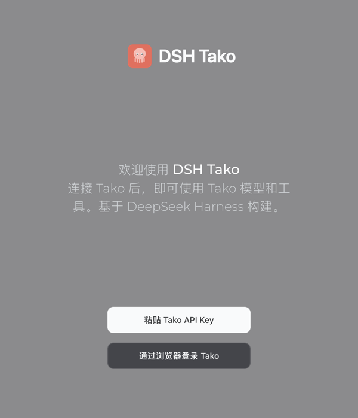
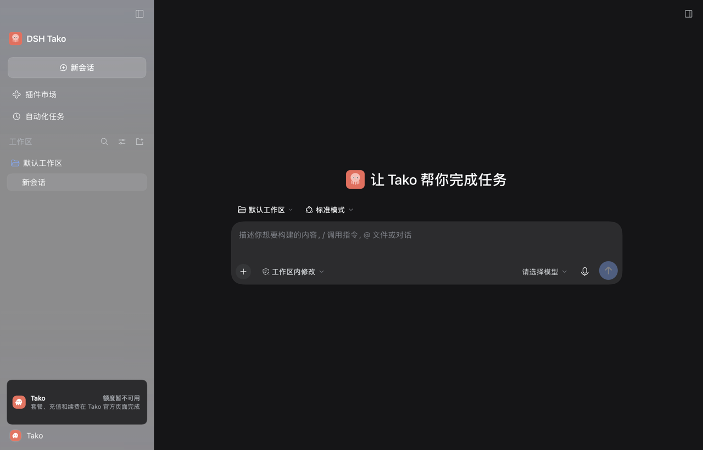

# DSH Tako

English | [中文](README.zh.md)

> Unofficial desktop distribution: DSH Tako is built on DeepSeek Harness (MIT) and is not affiliated with or endorsed by DeepSeek. The original DeepSeek Harness LICENSE and copyright notice are retained unchanged; the official README follows under [DeepSeek Harness](#deepseek-harness).

DSH Tako is a desktop agent application with Tako models and five Tako tools (search, image generation, speech recognition, speech synthesis, and quota query) built in. It supports browser sign-in to Tako, shows the Tako quota, and installs beside the official DSH desktop.






See the [DSH Tako user guide](docs/tako/user-guide.md) for the full guide, and the [maintainer guide](docs/tako/maintainers.md) for releases and following official versions.

## Download and install

Download from [GitHub Releases](https://github.com/tako-dev/dsh-tako-desktop/releases):

- **macOS (Apple Silicon)**: download `DSH-Tako-<version>-mac-arm64.dmg`, open it, drag DSH Tako to Applications, and launch it from Applications.
- **Windows (x64)**: download and run `DSH-Tako-<version>-win-x64.exe`. The installer is not code-signed; when SmartScreen appears, choose More info → Run anyway.

The `latest*.yml`, `.zip`, and `.blockmap` files feed in-app updates and need no manual download.

## First sign-in

The welcome screen offers two ways in: choose Sign in with Tako in browser, sign in and approve in the browser, and the app stores the API key; or choose Paste Tako API key and paste a key from the Tako website. Arc and similar browsers may open the authorization page in a small popup (such as Little Arc); finish authorizing there, then return to the app.

If you never pick a model, new chats use **Tako `deepseek-v4.1-flash`**, not the official DeepSeek default.

The sidebar footer (octopus icon) shows remaining **5h** and **weekly** plan windows as progress bars, plus wallet balance. Settings → General has **Check for updates** next to the version. The application menu item Check for Updates still works.

## DSH Tako and the npm plugin dsh-tako

The npm plugin `dsh-tako` only adds Tako models to the **official** DSH. DSH Tako is a **complete desktop application** that also includes browser sign-in, the Tako tools, the quota card, the Tako-branded interface, and its own automatic updates. The terminal command DSH Tako installs is also called `dsh-tako`; it shares the plugin's name but is a different thing.

## Running beside the official DSH

DSH Tako uses its own app ID `tech.shiroha.dsh-tako`, data directory `~/.dsh-tako`, terminal command `dsh-tako`, and URL scheme `dsh-tako://`, and takes updates only from this repository's GitHub Releases; the official DSH uses `~/.dsh` and `dsh`, so neither affects the other.

## Uninstall

- **macOS**: move DSH Tako from Applications to the Trash; if you installed the terminal command, delete `/usr/local/bin/dsh-tako`. To remove data, delete `~/.dsh-tako`, `~/Library/Application Support/DSH Tako`, `~/Library/Caches/dsh-tako-desktop-updater`, and `~/Library/Logs/DSH Tako`.
- **Windows**: uninstall DSH Tako under Settings → Apps → Installed apps. To remove data, delete `%USERPROFILE%\.dsh-tako`, `%APPDATA%\DSH Tako`, and `%LOCALAPPDATA%\dsh-tako-desktop-updater`.

## FAQ

- **The browser sign-in does not return**: once the browser reports completion, switch back to the app yourself; check whether the authorization page is still waiting in a popup, and note that a proxy or security software may block local loopback requests. The attempt times out after 10 minutes; you can paste an API key instead.
- **Invalid key**: make sure you copied the whole key and it is not disabled on the website; "Could not reach Tako" is a network problem, not an invalid key.
- **Quota looks wrong**: the 5h / weekly bars are the **subscription windows** (same as the Tako plan page). Wallet remainder is a different number, shown on its own line.
- **Update fails**: automatic updates need access to GitHub (there is no China CDN yet). Download from Releases and install over the old build; data stays. Unsigned macOS builds do not update automatically. You can also use Settings → General → Check for updates.
- **No model found**: choose a Tako model from the composer menu. A new install with no saved choice defaults to Tako `deepseek-v4.1-flash`.

See the [user guide troubleshooting section](docs/tako/user-guide.md) for more.

# DeepSeek Harness

DeepSeek Harness (`dsh`) is an open-source agent harness developed by [DeepSeek AI](https://deepseek.com).

It is built on an **everything-is-a-plugin** architecture and powered by [Cordis](https://github.com/cordiverse/cordis), whose design is described in [_A Programming Paradigm for Spatiotemporal Composability_](https://arxiv.org/abs/2608.25512).

Documentation: [https://deepseek-harness.github.io/deepseek-harness/](https://deepseek-harness.github.io/deepseek-harness/)

## Developer preview

DeepSeek Harness is in _developer preview_ and iterating rapidly. **THERE WILL BE COMPATIBILITY-BREAKING CHANGES.**

Review the [safety notice](SAFETY.md) before running the project.

## Run

### Run from `npm`

Install `Node.js`, then run:

```sh
npx @deepseek-ai/dsh web
```

The command starts the Web UI at `http://127.0.0.1:3080` by default and opens it in the default browser for a local launch. An SSH launch only prints the host URL because the SSH client or editor owns the local forwarded address. Pass `--no-open` to run the server without opening a browser. See [Web UI guide](docs/user/guide/index.md).

### Run from source

To run from a repository checkout:

```sh
git clone https://github.com/deepseek-ai/deepseek-harness.git
cd deepseek-harness
pnpm install
pnpm run build
pnpm dsh web
```

`pnpm run build` prepares the repository artifacts. `pnpm dsh web` uses those built artifacts without rebuilding.

## Community and support

- Submit feedback or bug reports through [GitHub Discussions](https://github.com/deepseek-ai/deepseek-harness/discussions).
- Add the [`dsh-plugin`](https://github.com/topics/dsh-plugin) topic to your plugin repository for discoverability.
- Join <a href="https://discord.gg/4MrtZUhpxg">DeepSeek Harness Discord community</a>.

## Contributing

See [CONTRIBUTING.md](CONTRIBUTING.md).

## Development

Start with the [development guide](docs/development.md) and [architecture documentation](docs/architecture.md).

`pnpm run dev:web` builds, serves, and rebuilds client bundles on source edits in one terminal, and `make help` lists the matching Make targets for Web and Desktop; the guide's application commands section owns the full table.

For agents, follow [AGENTS.md](AGENTS.md).

## Citation

```bibtex
@misc{deepseek-harness2026,
  title={DeepSeek Harness: Everything is a Plugin},
  author={DeepSeek-AI},
  year={2026},
  publisher={GitHub},
  howpublished={\url{https://github.com/deepseek-ai/deepseek-harness}},
}
```

## License

[MIT](LICENSE)

Third-party dependencies and their licenses are disclosed in [THIRD_PARTY_NOTICES.md](THIRD_PARTY_NOTICES.md).
